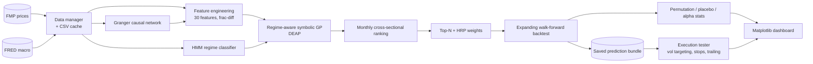

# Macro-Structural Alpha Engine

**A cross-asset, purely numerical research engine.** It uses genetic programming to evolve symbolic alpha formulas from flow, macro and commodity-linkage features. Each formula is conditioned on market regime and tested walk-forward with permutation and placebo tests.

> **Project status:** independent research project (January 2026). It is a medium-horizon, macro-and-flows counterpart to the author's order-book work in **[Lvl3Quant](https://github.com/njliautaud/Lvl3Quant)**. It is kept as a portfolio piece and is not maintained.

---

## Overview

The engine models the structural pressures that move assets over days to months:

- sector and macro context
- commodity input costs
- fund-flow proxies
- first- and second-order causal links between assets

It does not use NLP or news. Every input is price, volume or a macro series, and all features are lagged and smoothed. The output is a monthly cross-sectional ranking. The top-ranked assets are weighted with Hierarchical Risk Parity and backtested walk-forward against SPY.

## Key ideas

- **Multi-level relationship tracking.** Each asset is scored inside its sector, macro and commodity context. The universe covers about 220 equities in 9 sectors, about 85 ETFs (broad, sector, industry and commodity proxies), 24 commodity futures and 28 FRED macro series.
- **Causal network.** Pairwise Granger-causality tests (`statsmodels`) build a directed network of assets. PageRank centrality and upstream pressure features (1st and 2nd order) come from that network.
- **Second-order effects.** Explicit cost-input baskets, for example metals and energy acting on industrials and tech margins, produce cost-headwind, commodity-drag and second-order-impact features.
- **Stationarity-preserving features.** Fractional differentiation keeps long memory while making series stationary. It sits alongside momentum, volatility, beta, RSI/ATR, VWAP deviation and flow intensity or acceleration: 30 features in total.
- **Regime awareness.** A Gaussian HMM (`hmmlearn`) on macro series labels market regimes, and a separate symbolic model is evolved for each regime.
- **Symbolic regression.** DEAP genetic programming with `eaMuPlusLambda` evolves formulas. Full mode uses a population of 1,500, 100 generations and a maximum tree depth of 7. Lightweight mode uses 300, 25 and 4. Primitives include protected `log`, `exp`, `sqrt` and division, plus `sin`, `cos`, `tanh`, sigmoid, ReLU, max, min and comparisons. Fitness is rank IC (Spearman) with a bonus for positive alpha. Evaluation runs in a multiprocessing pool.
- **Dual engine.** One GA evolves the prediction (ranking) formula. A second, smaller GA learns exit and execution rules.

## Validation protocol

| Step | What it checks |
|---|---|
| Train / holdout split | Development on 2010 to 2022; 2023 to 2025 is the true holdout shown in the dashboard |
| Expanding walk-forward | Monthly rebalances; training expands to all history available at each rebalance; retraining cadence configurable (default quarterly) |
| Permutation test | Shuffles excess returns 500 times to get an empirical p-value against luck |
| Placebo test | Shifts features forward one rebalance period; real signal should decay |
| Alpha diagnostics | Annualized alpha and information ratio vs SPY, IC per rebalance, feature alpha loading, top-N selection alpha, vol-targeting impact, hit rate and average win/loss |

## Architecture



## Tech stack

Python 3.10+ · pandas / NumPy / SciPy · statsmodels (Granger causality) · hmmlearn · DEAP · scikit-learn · NetworkX · Matplotlib / seaborn · tqdm / psutil · data from Financial Modeling Prep and FRED

## Repository structure

| Path | Contents |
|---|---|
| `config.py` | Asset universe, commodity proxies, cost-input baskets, feature list, date windows, GA and alpha settings, API key placeholders |
| `data_manager.py` | FMP and FRED ingestion, CSV caching, cleaning, key-validity handling |
| `engine.py` | Fractional differentiation, HMM regimes, feature engineering, causal network, symbolic and execution GAs, HRP, walk-forward backtester, permutation and placebo tests |
| `run.py` | End-to-end pipeline: fetch, engineer, evolve, walk forward, validate, save |
| `train_and_predict.py` | Phase 1: train on 2010 to 2022 and save holdout predictions |
| `test_execution.py` | Phase 2: load a saved prediction bundle and compare execution methods side by side |
| `dashboard.py` | Scrollable Matplotlib dashboard |
| `PROJECT_PLAN.md` | Phase-by-phase roadmap and status |

## Running it

```bash
pip install -r requirements.txt
# set FMP_API_KEY and FRED_API_KEY in config.py to your own keys

python run.py               # full pipeline; prompts for "skip holdout retraining" and "lightweight mode"
python train_and_predict.py # Phase 1: train + save predictions to saved_models/
python test_execution.py    # Phase 2: pick a saved model, compare execution methods
```

The two-phase workflow lets you iterate on execution (vol targeting, stop-loss multiples, take-profit, trailing stops, top-N) without retraining the prediction model.

**Dashboard views:**

- walk-forward equity curves: executed vs shadow vs model-only
- dual-engine performance statistics
- sector flow rotation and flow pressure by group
- a dynamic sector-positioning heatmap
- feature alpha loading (directional IC)
- the evolved formula and current recommendations
- top alpha-contributing tickers
- an inter-market dependency matrix, focused on commodity-equity links

## Roadmap

Open items, from `PROJECT_PLAN.md`:

- dynamic volatility targeting inside the backtester
- regime-aware adaptive trailing stops
- catalyst-driven exits
- interactive zoom and scroll views
- macro-shock scenario simulation (for example "rates +50 bp")

## Disclaimer

This is research code for education, not investment advice. The repository makes no performance claims; run the validation suite and judge any result yourself.
